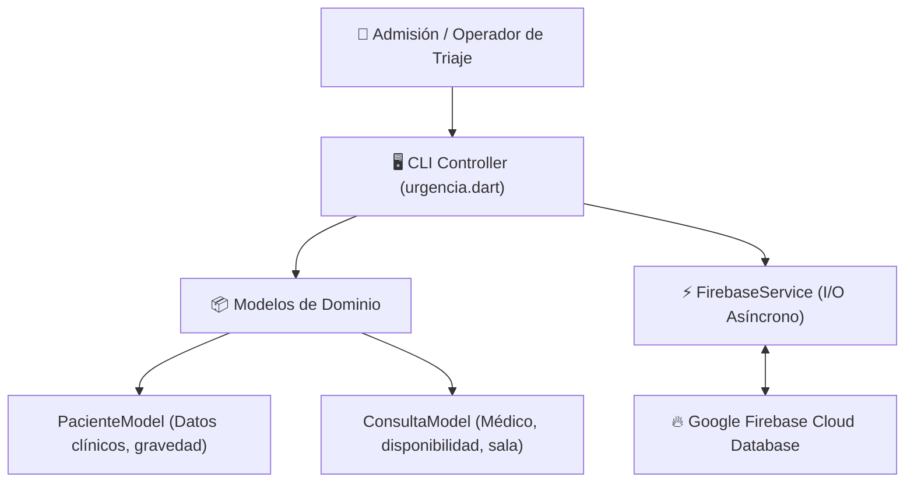

<div align="center">

# 🚑 Sistema de Urgencias y Triaje Sanitario
### *Gestión de Consultas y Pacientes en Tiempo Real con Dart y Google Firebase*

[](https://dart.dev/)
[](https://firebase.google.com/)
[](https://github.com/EduardoCruzmunioz/Urgencias)
[](LICENSE)

<p align="center">
  Software de triaje y gestión asistencial diseñado para agilizar la asignación de pacientes a consultas médicas en centros de salud y puestos de socorro, sincronizando el estado clínico en la nube en tiempo real mediante <b>Google Firebase</b>.
</p>

</div>

---

## 🎯 Problema que Resuelve

En situaciones de urgencia médica o alta afluencia sanitaria, la demora en clasificar pacientes y conocer la disponibilidad de las salas de consulta genera cuellos de botella críticos. 

Este sistema proporciona una **estación de triaje centralizada**, permitiendo:
- Conexión e hidratación instantánea de los médicos en activo desde Firebase.
- Asignación inteligente de pacientes a consultas según estado de ocupación y gravedad.
- Control del flujo completo de admisión, atención y alta hospitalaria.

---

## 🏗️ Arquitectura del Sistema

El proyecto sigue una arquitectura modular desacoplada con tipado estricto en Dart y persistencia reactiva asíncrona:



---

## 🚀 Características Principales

- **☁️ Sincronización Cloud en Vivo:** Inicialización reactiva de médicos y salas de consulta conectando directamente con los servicios de Google Firebase.
- **⏱️ Triaje Asistencial:** Registro ordenado de pacientes con cálculo de tiempos de espera y asignación médica.
- **🛡️ Tipado Fuerte y Seguridad:** Validación de datos en tiempo de ejecución garantizada por el sistema de tipos estático de Dart 3.
- **📦 Binario Standalone:** Incluye versión compilada nativa para Windows (`urgencias.exe`) sin necesidad de instalar SDKs en el equipo cliente.

---

## 📂 Estructura del Repositorio

```text
Urgencias/
├── bin/
│   ├── models/
│   │   ├── consulta_model.dart    # Entidad de consulta médica y disponibilidad
│   │   └── paciente_model.dart    # Entidad de paciente y datos clínicos
│   ├── service/
│   │   └── firebase_service.dart  # Cliente HTTP y serialización con Firebase
│   ├── utils/
│   │   └── utils.dart             # Utilidades de terminal, formato y limpieza
│   └── urgencia.dart              # Punto de entrada principal y bucle del sistema
├── pubspec.yaml                   # Definición de dependencias Dart (http, path)
├── urgencias.exe                  # Ejecutable nativo precompilado para Windows
└── README.md
```

---

## 💻 Puesta en Marcha

### Opción 1: Ejecutar el binario directo (Windows)
Descarga el repositorio y haz doble clic sobre `urgencias.exe` o ejecútalo desde terminal:
```powershell
./urgencias.exe
```

### Opción 2: Modo desarrollo (Dart SDK)
1. Clona el repositorio:
   ```bash
   git clone https://github.com/EduardoCruzmunioz/Urgencias.git
   cd Urgencias
   ```
2. Instala dependencias:
   ```bash
   dart pub get
   ```
3. Ejecuta la aplicación:
   ```bash
   dart run bin/urgencia.dart
   ```

---

## 👨‍💻 Autor

Desarrollado por **Eduardo Cruz Muñoz**  
- **Portfolio:** [eduardocruzdev.netlify.app](https://eduardocruzdev.netlify.app/)  
- **LinkedIn:** [linkedin.com/in/eduardo-cruz-muñoz2202](https://www.linkedin.com/in/eduardo-cruz-mu%C3%B1oz2202/)  
- **GitHub:** [@EduardoCruzmunioz](https://github.com/EduardoCruzmunioz)
